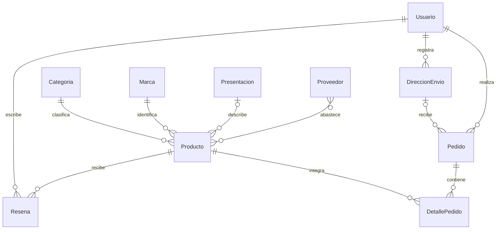

# Cervecería y Bebidas Artesanales — Backend

Sistema de gestión de catálogo, clientes y pedidos de una cervecería y tienda de bebidas artesanales. Backend de la EFI 2026 de Ingeniería de Software, conectado al futuro frontend de Programación III.

## Integrantes

- Benjamín De Lauro
- Ignacio Piñeiro
- Esteban Rodríguez

## Tecnologías

Python, Django, Django REST Framework, SQLite y uv. Las dependencias se fijan en `uv.lock`.

## Planificación de la base de datos

La consigna vigente requiere al menos **10 modelos propios relacionados**. A los seis modelos iniciales se suman Presentacion, Proveedor, DireccionEnvio y Resena. La planificación de campos, relaciones y reglas se encuentra en [docs/modelos.md](docs/modelos.md).



## Ejecución local

Se necesita Python 3.12 o superior y [uv](https://docs.astral.sh/uv/).

```shell
uv sync --locked
uv run python manage.py migrate
uv run python manage.py createsuperuser
uv run python manage.py runserver
```

El administrador está disponible en `http://127.0.0.1:8000/admin/`. La base SQLite, los usuarios locales, las imágenes y `.venv` no se suben a Git.

## Verificación

```shell
uv run python manage.py check
uv run python manage.py makemigrations --check --dry-run
uv run python manage.py test
```

## Organización y alcance

Cada aporte se desarrolla en una rama `feature/*` y se propone mediante un Pull Request hacia `develop`. La versión final deberá integrarse a `main`.

Este aporte se concentra en completar los modelos, sus migraciones, pruebas y administración. Los requisitos restantes de API mediante ViewSets, autenticación, bienvenida, CORS, documentación de API, Docker y frontend se completarán en sus respectivas tareas. El nombre comercial definitivo y las capturas de funcionamiento también quedan pendientes para la entrega.
