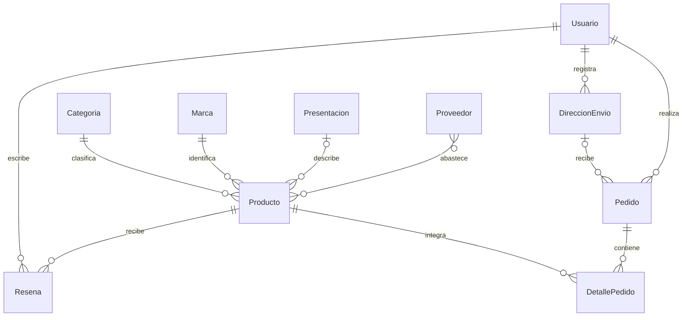
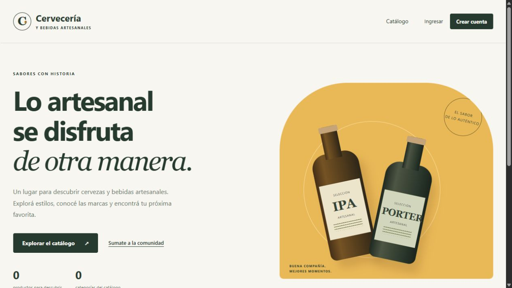
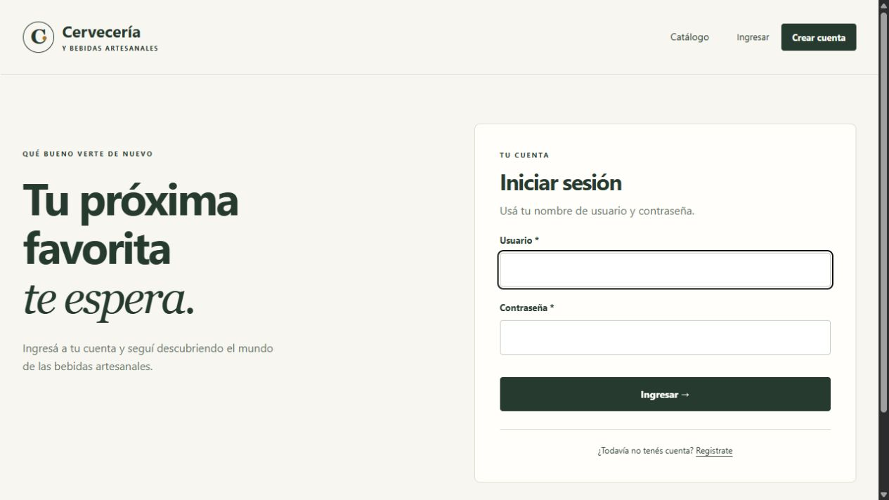

# Cervecería y Bebidas Artesanales — Backend

Sistema de gestión de catálogo, clientes y pedidos de una cervecería y tienda de bebidas artesanales. Backend de la EFI 2026 de Ingeniería de Software, conectado al futuro frontend de Programación III.

## Integrantes

- Benjamín De Lauro
- Ignacio Piñeiro
- Esteban Rodríguez

## Tecnologías

Python, Django, Django REST Framework, SQLite y uv. Las dependencias se fijan en `uv.lock`.

## Planificación de la base de datos

La consigna vigente requiere al menos **10 modelos propios relacionados**. A los seis modelos iniciales se suman Presentacion, Proveedor, DireccionEnvio y Resena. La planificación de campos, relaciones y reglas se encuentra en [docs/modelos.md](docs/modelos.md).



## Ejecución local

Se necesita Python 3.12 o superior y [uv](https://docs.astral.sh/uv/).

```shell
uv sync --locked
uv run python manage.py migrate
uv run python manage.py configurar_grupos
uv run python manage.py createsuperuser
uv run python manage.py runserver
```

La bienvenida está disponible en `http://127.0.0.1:8000/` y el administrador en `http://127.0.0.1:8000/admin/`. La base SQLite, los usuarios locales, las imágenes y `.venv` no se suben a Git.

## Usuarios, pantallas y permisos

- Registro: `/usuarios/registro/`. Crea una cuenta del grupo **Clientes** y abre su sesión.
- Login: `/usuarios/login/`. Logout mediante POST: `/usuarios/logout/`.
- Catálogo público con búsqueda y paginación: `/catalogo/productos/`.
- Altas, edición y eliminación de productos y categorías mediante templates, protegidas con los permisos de Django.
- Grupo **Gestores de catálogo** configurado mediante `configurar_grupos`. Un administrador puede asignarlo desde Usuarios. El comando se puede repetir y no convierte a sus miembros en personal ni superusuarios.
- Context processor propio, mensajes de confirmación, CSRF y pantallas adaptables a dispositivos móviles.
- API de autenticación por token: `/api/auth/login/`, `/api/auth/me/` y `/api/auth/logout/`. También se habilitan las sesiones y el acceso navegable en `/api-auth/login/`.

Los pasos de prueba, la matriz de permisos y el contrato para integrar la API se detallan en [docs/autenticacion.md](docs/autenticacion.md).

### Capturas de funcionamiento

Bienvenida del backend:



Inicio de sesión:



## Verificación

```shell
uv run python manage.py check
uv run python manage.py makemigrations --check --dry-run
uv run python manage.py test
```

## Organización y alcance

Cada aporte se desarrolla en una rama `feature/*` y se propone mediante un Pull Request hacia `develop`. La versión final deberá integrarse a `main`.

La rama de modelos completa las tablas, sus migraciones y administración. La rama `feature/autenticacion` incorpora las sesiones, tokens, permisos, bienvenida y gestión mediante templates. Parte de `feature/models`; su PR se revisa inicialmente contra esa rama para mostrar únicamente el aporte de autenticación. Cuando modelos se integre a `develop`, también se deberá cambiar la base del PR de autenticación a `develop`.

La API de catálogo se desarrolla en `feature/api-rest`. Las vistas HTML se mantienen en `catalogo/vistas_web.py` y `catalogo/urls_web.py` para facilitar la integración con esa API. Los requisitos restantes de ViewSets, CORS, documentación de API, Docker y frontend corresponden a sus tareas. El nombre comercial definitivo y las capturas finales también quedan pendientes para la entrega.
